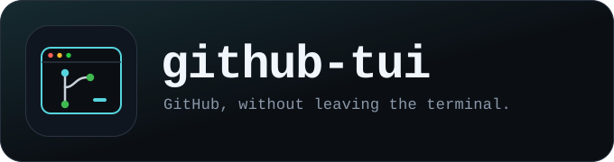
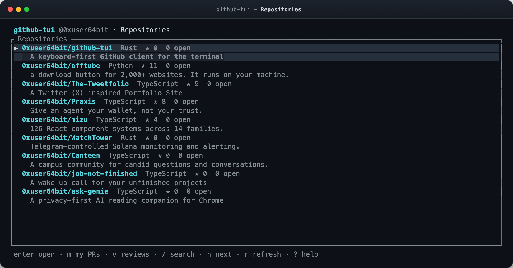
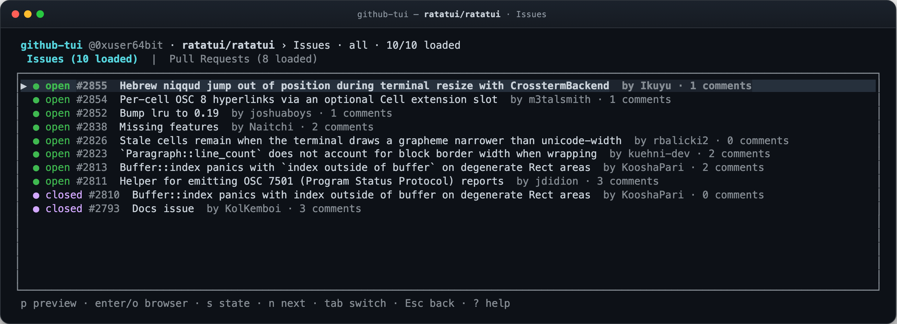
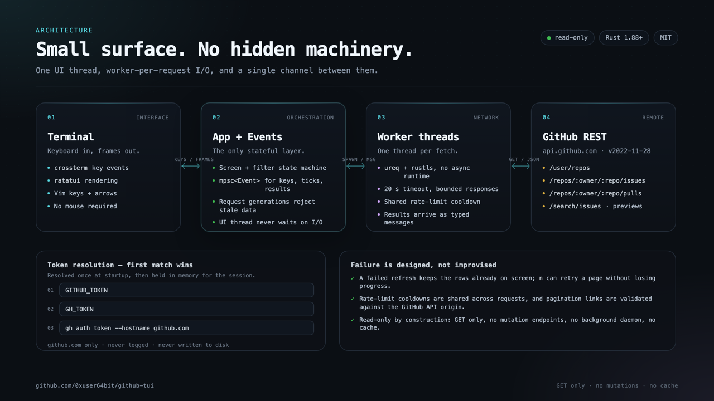

<p align="center">
  
</p>

<p align="center">
  <a href="https://github.com/0xuser64bit/github-tui/actions/workflows/ci.yml"></a>
  <a href="LICENSE"></a>
  
  
</p>

<p align="center">
  <b>Read-only. Keyboard-first. Out of your way.</b><br>
  Browse repositories, issues, and pull requests without leaving the terminal.
</p>

<p align="center">
  
  <br>
  <sub>Sample data. Rendered by the real Ratatui UI.</sub>
</p>

`github-tui` is a small Rust terminal client for the in-between moments: checking what broke, skimming a pull request, clearing your review queue, or finding an issue without opening a browser. It is **pre-1.0 and read-only by design**: every action that changes GitHub stays where it belongs, in GitHub.

## Why another GitHub client?

- **Keyboard first.** Vim motions, arrow keys, single-key actions, and an in-app help overlay. Your hands stay on the home row.
- **Read-only by design.** No accidental comments, merges, or state changes. A read-only token is enough.
- **Fast and local.** One Rust binary, no daemon, no database, no telemetry. Network work runs on worker threads, so the UI never waits.
- **Honest about incomplete data.** Search filters loaded rows, pagination has an explicit next-page key, and warnings appear when GitHub caps results.
- **Small surface area.** `github.com` only, `GET` requests only, no disk cache, and a token that is never persisted.

## What it does

- **Repository inbox**: every repository you own, collaborate on, or reach through an organization, sorted by recent activity.
- **Issues and pull requests**: separate tabs with state, author, draft and merged markers, and comment counts on issues. State filters compose with text search.
- **Your personal queues**: `m` shows pull requests you authored across all repositories; `v` shows open pull requests requesting your review.
- **On-demand previews**: `p` fetches an issue or PR description without leaving the list. Scroll with `j`/`k`; open the item in your browser when you need more.
- **Search that tells the truth**: `/` filters the rows already loaded by repository name or description, title, author, or number. It does not silently pretend to search GitHub's full history.
- **A clean browser handoff**: `o` opens the selected repository, issue, or PR on github.com after validating the URL. `Enter` drills into repositories and opens issues or pull requests in the browser.

<p align="center">
  
  <br>
  <sub>Issues and pull requests share one repository view. State and text filters compose.</sub>
</p>

## Keys you'll use

| Key | Action |
| --- | --- |
| `↑` / `k`, `↓` / `j` | Move the selection |
| `g` / `Home`, `G` / `End` | Jump to the first or last row |
| `Enter` / `l` / `→` | Open a repository, or open the selected issue/PR in the browser |
| `Esc` / `h` / `←` | Go back |
| `Tab` | Switch Issues / Pull Requests |
| `m` | Your pull requests |
| `v` | Open pull requests requesting your review |
| `p` | Preview the selected issue or PR |
| `/` | Search the loaded rows |
| `s` | Cycle state: all → open → closed → merged (issues skip merged) |
| `n` | Load the next page, keeping existing rows |
| `o` | Open the selection on github.com |
| `r` | Refresh the current view |
| `?` | Toggle help |
| `q` / `Ctrl-C` | Quit |

The [user guide](docs/usage.md) covers every mode, search semantics, pagination, and troubleshooting.

## Quick start

**Requirements:** Rust 1.88+ and a github.com account. The app runs on Linux, macOS, and Windows. There are no packaged releases yet, so build from source.

```sh
git clone https://github.com/0xuser64bit/github-tui.git
cd github-tui
cargo run --release
```

To install the binary on your `PATH` instead:

```sh
cargo install --locked --path .
github-tui
```

### Authenticate

If you already use the GitHub CLI, reuse its session:

```sh
gh auth login --hostname github.com
```

Or export a token for the current shell:

```sh
export GITHUB_TOKEN=github_pat_...
cargo run --release
```

The app resolves a token once at startup; the first available source wins:

1. `GITHUB_TOKEN`
2. `GH_TOKEN`
3. `gh auth token --hostname github.com`

For a fine-grained token, grant **Metadata: read**, **Issues: read**, and **Pull requests: read**, and select only the repositories you need. A classic token with the `repo` scope also works, but grants broad write access even though `github-tui` only sends `GET` requests. The app never logs the token or writes it to disk.

Only **github.com** is supported. The app does not select GitHub Enterprise credentials, even when `GH_HOST` points elsewhere.

## Under the hood

<p align="center">
  
</p>

One UI thread owns state and draws. A bounded pool runs up to four fetches concurrently, and a single `mpsc` channel carries input, ticks, and results. Leaving a view cancels its queued fetches; request generations discard late responses. There is no async runtime, background daemon, or disk cache.

Read [the architecture guide](docs/architecture.md) for the state machine, concurrency model, API surface, and failure behavior.

## Scope, deliberately

- **Read-only.** No creating, editing, commenting, reviewing, or merging. Open the browser for that.
- **`github.com` only.** GitHub Enterprise is not supported.
- **Search is local to loaded rows.** Use `n` to load more pages; Search API queues expose at most 1,000 results and have tighter rate limits.
- **No cache, notifications, or rich Markdown.** Previews show plain text exactly as stored in the issue or PR body.
- **Live data is not a snapshot.** Pages can shift while you browse, and GitHub's API rate limits still apply.
- **Unofficial.** `github-tui` is not affiliated with or endorsed by GitHub.

## Development

```sh
cargo fmt --all -- --check
cargo clippy --locked --all-features --all-targets -- -D warnings
cargo test --locked --all-features --all-targets
RUSTDOCFLAGS="-D warnings" cargo doc --locked --no-deps --all-features
cargo test --test live -- --ignored --nocapture   # credentialed live smoke test
```

Default tests use local HTTP fixtures; they never call GitHub. CI runs formatting, Clippy, documentation, the test suite on Linux/macOS/Windows, and the minimum compiler (Rust 1.88). See [CONTRIBUTING.md](CONTRIBUTING.md) before opening a pull request.

## Documentation

| Read this | If you want to… |
| --- | --- |
| [User guide](docs/usage.md) | Install, authenticate, learn every key, understand limits, and troubleshoot |
| [Architecture](docs/architecture.md) | Follow a request through the app and understand its design trade-offs |
| [Contributing](CONTRIBUTING.md) | Build, test, and submit a change |
| [Security](SECURITY.md) | Report a vulnerability or understand the token and network model |

## License

Licensed under the MIT license. See [LICENSE](LICENSE).

`github-tui` is an independent project. GitHub is a trademark of GitHub, Inc.
