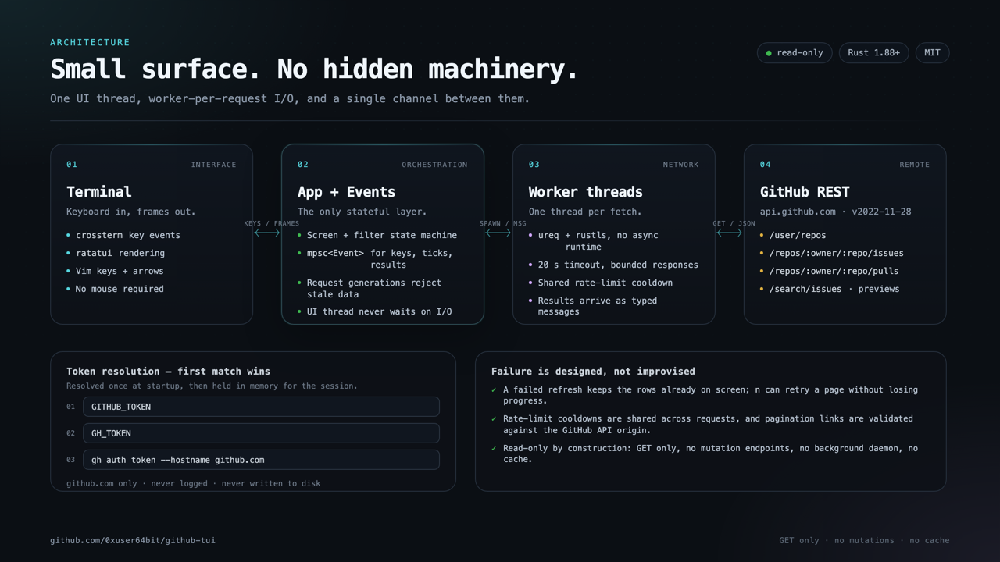

# Architecture

<p align="center">
  
</p>

`github-tui` is a single-process Rust application. One thread owns the screen and all application state. A lazy, session-owned pool runs at most four network fetches concurrently and queues at most sixteen more. A single `mpsc` channel carries terminal input, animation ticks, and fetch results back to the UI thread.

That design keeps the code small enough to read in an afternoon and keeps slow network calls off the render path. There is no async runtime, background daemon, disk cache, or shared application state between threads.

## Design goals

1. **The UI never waits on the network.** Input and rendering stay responsive while GitHub is slow, rate-limited, or unreachable.
2. **Read-only by construction.** The client exposes `GET` operations only. No mutation endpoint is modeled, so a keypress cannot accidentally change GitHub state.
3. **Incomplete data is visible.** Loaded-row search, explicit pagination, retained rows on failure, and Search API warnings are preferred over silent guesses.
4. **Small dependency and credential surface.** Blocking HTTP, native TLS through rustls, one token resolved at startup, and no persistence.
5. **Testable boundaries.** GitHub responses are typed resources; the network client is testable against local HTTP fixtures; rendering runs against a Ratatui test backend.

## Startup

`src/main.rs` is deliberately thin:

1. Resolve a token through `auth::resolve_token()`.
2. Build an optional `Github` client. A missing token is not fatal; the UI renders an authentication screen instead.
3. Create `Events`, which starts the terminal input thread and the 200 ms tick thread.
4. Enter the alternate screen with `ratatui::init()`.
5. Run `App::run`, blocking on events from the channel and drawing when state changes.
6. Restore the terminal after the loop exits.

Token resolution happens **before** terminal setup so that `gh` can print normally and a failed lookup cannot leave the terminal in raw mode. The precedence is `GITHUB_TOKEN` → `GH_TOKEN` → `gh auth token --hostname github.com`; the app skips blank values and pins the CLI lookup to github.com.

## Module map

| Module | Responsibility |
| --- | --- |
| `main.rs` | Token/client setup, terminal lifecycle, error boundary |
| `auth.rs` | Environment and GitHub CLI token resolution |
| `app.rs` | Screens, key handling, search/filter state, request dispatch, background fetch coordination |
| `event.rs` | `Event`/`Message` types, the input thread, the tick thread, and the shared channel |
| `requests.rs` | Bounded fetch workers, nonblocking queue admission, cancellation, and shutdown |
| `github.rs` | Blocking REST client, pagination, response bounds, URL validation, HTTP error translation |
| `models.rs` | Serde models for only the GitHub fields the UI renders |
| `ui.rs` | Pure Ratatui rendering, layout, help/auth/preview overlays |
| `lib.rs` | Library surface used by the binary and integration tests |

The crate is split into a library (`github_tui`) and a thin binary. This keeps application logic testable without spawning a process or touching a real terminal.

## Request lifecycle

```text
key press
   │
   ▼
App::on_key ──► state transition ──► bounded fetch queue
   │                                      │
   │                                      ▼
   │                              Github::* page call
   │                                      │
   │                                      ▼
   │                              Message { request, repo, result }
   │                                      │
   ▼                                      ▼
Terminal draw ◄── refilter ◄── generation check ◄── Events::next
```

A concrete fetch looks like this:

1. The input thread forwards a crossterm key event to the channel.
2. `App::on_key` mutates UI state and, when required, starts a fetch.
3. `ListProgress::start` records a generation, a cancellation handle, and an in-flight flag. The app coalesces repeated requests for the same loading resource. Queue admission does not wait for an available worker; a full queue or worker-start failure follows the ordinary error-result path instead of leaving a spinner running.
4. The worker calls the typed `Github` method and sends a `Message` with the generation and, for repository-scoped requests, the repository name.
5. `App::on_message` rejects results from an older generation or a repository the user has already left. A late response cannot overwrite a newer view.
6. A successful page updates `Load`, replaces or appends items, records the next cursor, and clears errors. A failed refresh leaves the loaded list intact and stores an error notice.
7. `refilter` rebuilds the visible index vectors from the new data and clamps the selection.
8. The loop draws the updated state.

The event loop blocks on `Events::next()`. Terminal events and messages always request a redraw. Tick events request one only while a spinner is active, so an idle loaded list does not repaint twice per second.

## State model

### Screens

| Screen | Contents | Entered by |
| --- | --- | --- |
| `Repos` | Repository inbox | Startup, `Esc` from other screens |
| `RepoDetail` | Issues and pull requests for one repository | `Enter` on a repository |
| `MyPulls` | Authored PRs or review requests | `m` or `v` |

`Tab` switches between Issues and Pull Requests inside `RepoDetail`. `MyPulls` has a `review_mode` flag that selects the query and title.

### Loading state

Each remote resource has a `Load<T>` state:

| Variant | Meaning |
| --- | --- |
| `Idle` | Not requested yet |
| `Loading` | A request is in flight; the previous value is not available |
| `Loaded(T)` | Last successful result |
| `Failed(String)` | An initial request failed; the message is user-facing |

List screens additionally keep a `ListProgress` with:

- a request generation and in-flight flag;
- the next continuation cursor;
- the last error notice;
- a warning from GitHub;
- a set of completed cursors to detect pagination cycles.

The app stores an error on a **loaded** list in `ListProgress.error` instead of replacing the list with `Failed`. This is what makes a failed refresh keep useful rows visible. An error on an **initial** load becomes `Failed` and replaces the body with the actionable message.

### Selection and filtering

Lists use Ratatui's `ListState` over *filtered index vectors* (`filtered_repos`, `filtered_issues`, and so on). The indices point back into the loaded data, so filtering never copies or reorders the source list. `refilter` rebuilds those vectors from the current query and state filter, then clamps the cursor to the visible length.

Search is a case-insensitive substring match over loaded data only. Issues and PRs match title, author, and number (the app strips an optional leading `#` from the number query). Repositories match name, full name, and description. Personal PR queues also match repository names.

Key handling has a clear precedence:

1. `Ctrl-C` always quits.
2. The help overlay consumes the next key.
3. The preview overlay owns navigation, retry, browser, and close keys.
4. Search mode owns text input and navigation.
5. The active screen handles global actions and list movement.

This ordering is why `n` types a character during search but pages a list otherwise.

## Concurrency model

- **UI thread:** owns `App`, all state, all rendering, and all terminal writes. It never performs HTTP, file I/O, or browser process waits.
- **Input thread:** blocks on `crossterm::event::read` and forwards terminal events. An input failure is sent to the UI as an error so the terminal can be restored.
- **Tick thread:** emits an `Event::Tick` every 200 ms. Spinner frames advance only while a fetch is active.
- **Worker threads:** four per application, started lazily on the first fetch. They take work from a bounded FIFO queue, release its lock before running HTTP, and use cheap clones of the reference-counted `ureq::Agent`.
- **Browser reaper:** the app spawns browser launchers with null stdio and waits on them in a worker thread, so a slow launcher cannot stall the UI.

The mutable cross-thread state is the event channel, the worker queue, cancellation flags, and the client's shared rate-limit cooldown (`Arc<Mutex<Option<(Instant, Duration)>>>`). There are no locks around app data because app data never leaves the UI thread.

Invalidating a request cancels its queued work. Workers skip cancelled jobs, and each submission removes cancelled jobs before checking queue capacity, so abandoned views cannot fill the pending queue. A request that has already started may finish within the HTTP timeout; its generation still prevents stale results from changing the app. Dropping the application discards queued jobs and wakes idle workers without joining active HTTP requests. Keeping a personal queue in the background intentionally does not invalidate its request.

The app uses blocking `ureq` on bounded workers instead of an async runtime because the workload is a handful of independent page requests, not high concurrency. This removes a large dependency surface and makes cancellation and generation logic explicit in application code. The UI can briefly take the queue lock, but never holds it during HTTP and never waits for queue capacity.

## Network layer

### Endpoints

| Operation | Request |
| --- | --- |
| Current user | `GET /user` |
| Repository inbox | `GET /user/repos` |
| Issues | `GET /repos/{owner}/{repo}/issues` |
| Pull requests | `GET /repos/{owner}/{repo}/pulls` |
| Authored PRs | `GET /search/issues` with `type:pr author:{login}` |
| Review requests | `GET /search/issues` with `type:pr review-requested:{login} state:open` |
| Preview | `GET /repos/{owner}/{repo}/issues/{number}` |

List endpoints request `per_page=100`. The repository inbox adds `sort=updated` and `affiliation=owner,collaborator,organization_member`; the issue and pull-request lists request `state=all`; personal queues add `sort=updated&order=desc`. Search query values are percent-encoded as one complete value so user data cannot introduce extra parameters.

Every request sends:

```http
Authorization: Bearer <token>
Accept: application/vnd.github+json
X-GitHub-Api-Version: 2022-11-28
User-Agent: github-tui/<version>
```

The issues endpoint also returns pull requests; `issues_page` filters them out after deserialization while preserving the page's continuation link. The preview endpoint is issue-shaped and works for pull requests too, which is why one `ItemDetail` model serves both.

### Pagination

GitHub returns a `Link` header containing the next page URL. The client:

- parses the `rel="next"` URL;
- validates that it uses the same scheme and authority as the configured API root;
- refuses continuations outside `https://api.github.com`, including user-info tricks, other hosts, and http URLs;
- rejects a page whose next URL equals the current URL, and stops if a cursor repeats.

The UI loads one page per `n`. It does not eagerly collect the whole history. `collect_pages` exists for the live smoke test and internal convenience, not for interactive browsing; it treats a Search warning as an error rather than silently returning a partial list.

### Bounds and error handling

- The HTTP agent is HTTPS-only with a 20-second global timeout.
- The client follows redirects but forwards the bearer token only to the same host.
- The client bounds response bodies before and after decompression: 10 MiB for list/detail payloads, 16 KiB for error messages.
- The client maps HTTP status errors to actionable messages for 401, 403 (including the distinct rate-limit case), 404, 422, 429, and 5xx.
- Rate-limit responses record a shared cooldown derived from `Retry-After` or `X-RateLimit-Reset`.
- A failed later page leaves earlier pages and the retry cursor intact.
- The manual `Debug` implementation for `Github` redacts the token.

Search pagination can stop at 1,000 results and may report `incomplete_results`. Those conditions become warnings attached to the list; they are not presented as complete data.

## Rendering

`ui::render` lays out five vertical regions: header, optional search bar, body, optional notices, and footer. The body is a list, a tabbed detail view, a queue, or the authentication screen. Help and preview are centered overlays that clamp to the terminal area.

- The accent color is cyan; open states are green; closed states are magenta; merged states use cyan.
- Lists use a highlighted selection row and a `▶` marker.
- Preview scrolling uses Ratatui's wrapped line count to clamp the scroll offset.
- Previews do not parse Markdown; bodies render as plain, wrapped text.
- The UI uses standard ANSI colors plus two indexed background shades, so it inherits the terminal palette. It does not read a config file or expose a theme setting.

Rendering is pure with respect to remote data: it reads `App` state, updates widget list state, and clamps preview scrolling. It never starts a fetch.

## Security boundaries

- The app resolves the token once, holds it in memory, sends it only to the GitHub API host, and redacts it from debug output. It never writes the token to disk.
- The client models read operations only. There is no generic “request arbitrary method” API.
- The app restricts browser launches to canonical `https://github.com/...` URLs with no query string and a conservative path character set. It detaches the process and reaps it off the UI thread.
- The client validates API pagination links before attaching the token.
- The client bounds response sizes.

The security model and reporting process are in [SECURITY.md](../SECURITY.md).

## Testing

- Unit tests live beside the code and cover state transitions, search/filter composition, rendering, token precedence, URL validation, pagination parsing, rate-limit behavior, and error messages.
- Network tests start a local `TcpListener`, return synthetic HTTP responses, and assert the exact request headers, continuation handling, and failure paths. Default tests never reach GitHub.
- One ignored integration test (`tests/live.rs`) exercises the live credential → REST → model path for maintainers. It fails clearly when credentials are absent and treats incomplete Search results as a failure.
- CI runs formatting, Clippy with warnings denied, rustdoc with warnings denied, tests on Linux/macOS/Windows, and the declared minimum compiler (Rust 1.88).

## Trade-offs

The application chooses a small, legible design over a feature-complete GitHub client:

- **REST over GraphQL.** Simpler typed models and pagination, at the cost of more requests for some views.
- **Bounded blocking workers over async.** Four active fetches and sixteen pending jobs bound resource use without a runtime. Already-running requests cannot be cancelled; timeout and generation checks contain their lifetime and effects.
- **Loaded-row search over remote search.** Instant, free, and honest about what is loaded; it cannot find unseen history.
- **Search API for personal queues.** Necessary to answer “my PRs across all repos,” with GitHub's 1,000-result cap and tighter rate limit as the trade-off.
- **Plain-text previews over Markdown rendering.** Small dependency surface and no HTML sanitizer; complex descriptions are less pretty.
- **No cache.** Always live, never stale on disk, at the cost of refetching after every restart.
- **Read-only.** A smaller token and no confirmation flows for destructive actions; mutations stay in the browser.

## Extending the client

A new read-only view generally touches five places:

1. Add or extend a model in `models.rs`.
2. Add a `Github` method and a request fixture test in `github.rs`.
3. Add a `Message` variant and a `ListProgress`/`Load` field in `app.rs`.
4. Add key handling, fetch dispatch, and filter logic in `app.rs`.
5. Render the state in `ui.rs` and update [usage](usage.md).

Treat scope changes that add mutation endpoints, background sync, or persistent credentials as architectural changes, not routine feature work. The current security and simplicity guarantees depend on those boundaries.
