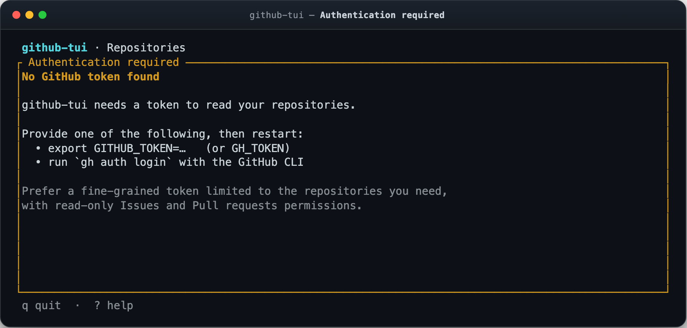
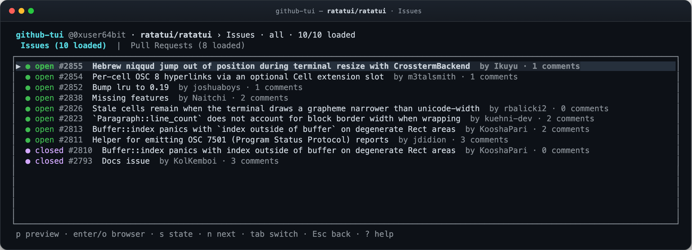
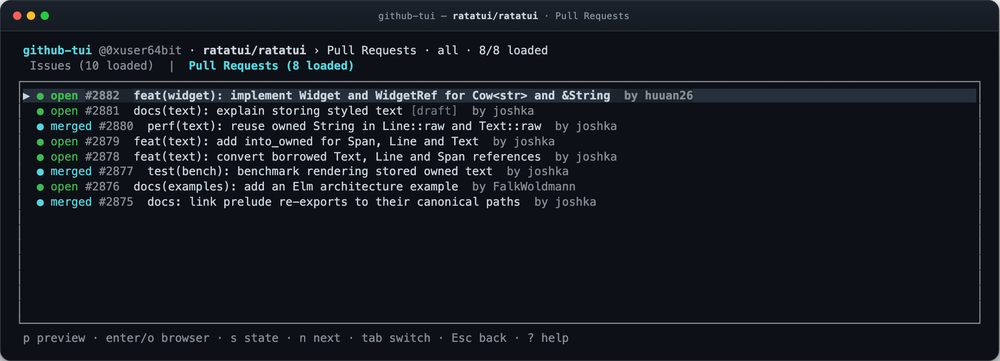
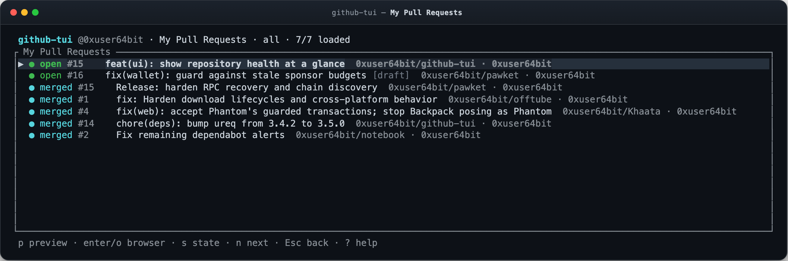
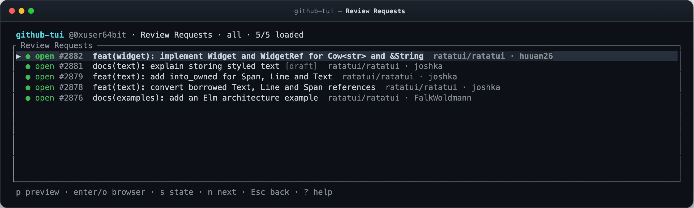
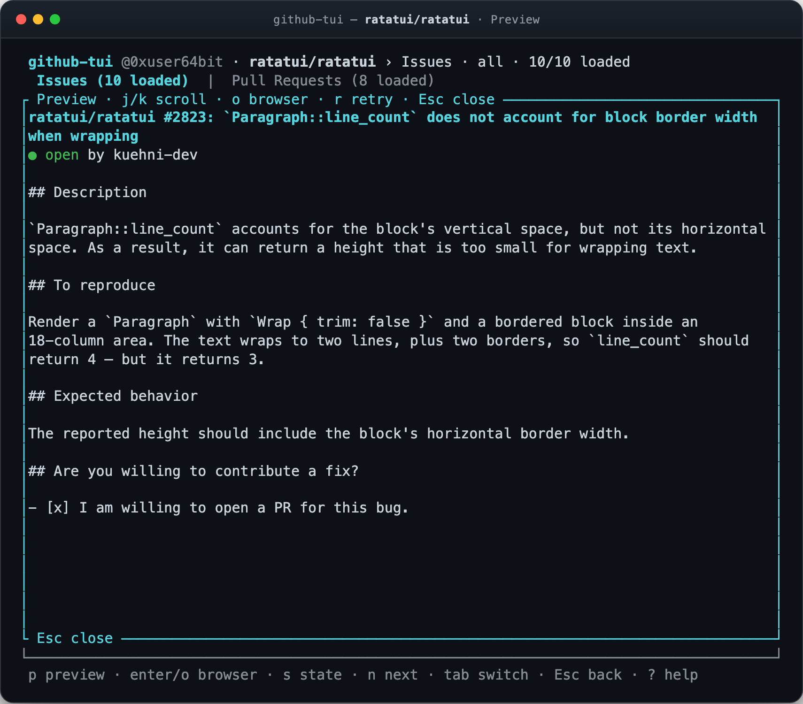
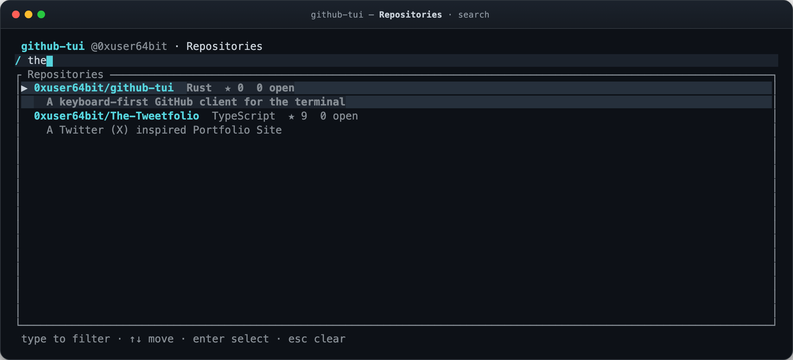
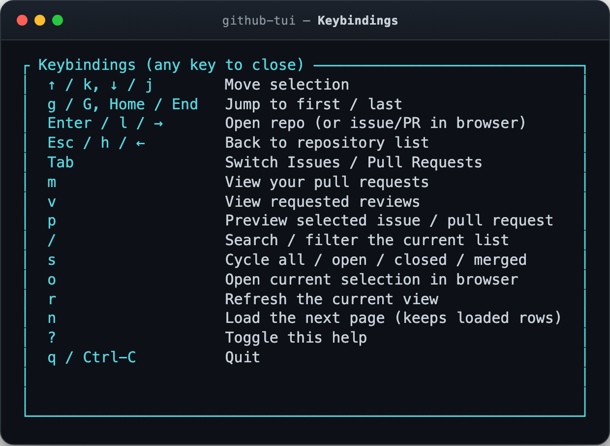

# User guide

`github-tui` is a read-only terminal client for browsing GitHub repositories, issues, and pull requests on **github.com**. This guide covers installation, authentication, every screen, search and pagination semantics, and what to do when something goes wrong.

If you are new, start with the [README quick start](../README.md#quick-start).

**Contents**

- [Install](#install)
- [Authenticate](#authenticate)
- [A tour of the screens](#a-tour-of-the-screens)
- [Keyboard reference](#keyboard-reference)
- [Search and filters](#search-and-filters)
- [Pagination, refresh, and failures](#pagination-refresh-and-failures)
- [Rate limits and completeness](#rate-limits-and-completeness)
- [Common workflows](#common-workflows)
- [Troubleshooting](#troubleshooting)
- [Limits and non-goals](#limits-and-non-goals)

> Screenshots use illustrative sample data. The real application UI renders them, not a mockup.

## Install

`github-tui` is pre-1.0 and has no packaged release artifacts yet. Build it from source with **Rust 1.88 or newer**:

```sh
git clone https://github.com/0xuser64bit/github-tui.git
cd github-tui
cargo run --release
```

To put the binary on your `PATH`:

```sh
cargo install --locked --path .
github-tui
```

The release profile uses link-time optimization, strips symbols, and produces a single native binary. There is no installer, runtime, database, or background service. The same codebase runs on Linux, macOS, and Windows.

The app takes over the terminal and restores it on exit, including on early errors. `q`, `Ctrl-C`, or closing the terminal ends the session.

## Authenticate

The app resolves a token once at startup. The first available source wins:

1. `GITHUB_TOKEN`
2. `GH_TOKEN`
3. `gh auth token --hostname github.com` if you have the [GitHub CLI](https://cli.github.com) installed and logged in

If you already use the GitHub CLI, reuse its session:

```sh
gh auth login --hostname github.com
github-tui
```

Or provide a token for one shell:

```sh
export GITHUB_TOKEN=github_pat_...
github-tui
```

The app keeps the token in memory for the session, never logs or renders it, and never writes it to disk. Resolution happens before the app takes over the terminal, so a missing CLI or failed `gh` command does not corrupt the display.

**Only github.com is supported.** The app pins the CLI fallback to `--hostname github.com` and ignores `GH_HOST` and GitHub Enterprise credentials.

### Recommended token scopes

Use a fine-grained personal access token with read-only access to the repositories you want to browse:

| Permission | Access |
| --- | --- |
| Metadata | Read (required to list repositories) |
| Issues | Read |
| Pull requests | Read |

Select only the repositories you need. For public repositories, a fine-grained token scoped to public repositories is enough.

A classic token with the `repo` scope also works, but grants broad write access. `github-tui` never uses that access: every request it makes is a `GET`. If you prefer the smallest possible credential, use a fine-grained read-only token.

For organization-owned repositories, the organization may need to approve the token. If a repository is visible in GitHub but missing here, check token access first.

### What the app never stores

There is no configuration file, credential store, cache directory, telemetry, or auto-update check. Environment variables and the `gh` CLI are the only configuration surface.

<p align="center">
  
</p>

If no token is found, the app still starts and shows this screen instead of failing. Set a token, then restart `github-tui`; the app does not re-resolve tokens on the fly.

## A tour of the screens

### Repositories

Start in the repository inbox. It lists repositories you own, collaborate on, or reach as an organization member, most recently updated first.

Each row shows the repository name, private/archived/fork markers, primary language, stars, and GitHub's open item count (which includes open pull requests). The description appears underneath when present.

- Press `Enter`, `l`, or `→` to open a repository.
- Press `o` to open the repository on github.com without drilling in.
- Press `m` or `v` to jump to a personal pull-request queue from anywhere in the repository list.
- Press `/` to filter loaded repositories by name, full name, or description.

### Repository detail

Opening a repository loads its **Issues** and **Pull Requests** in separate tabs. The app fetches both from GitHub when the repository opens, so switching tabs with `Tab` is instant after the first load.

<p align="center">
  
  <br>
  <sub>Issues include author and comment count.</sub>
</p>

<p align="center">
  
  <br>
  <sub>Pull requests distinguish open, merged, closed, and draft.</sub>
</p>

Pull requests come from the repository's pull-request endpoint, where GitHub reports both open and closed PRs. The interface labels merged PRs as **merged**, not **closed**. Drafts carry a `[draft]` marker. The Issues tab uses GitHub's issues endpoint and filters out the pull requests that endpoint also returns.

Press `p` to preview the selected item. Press `Enter`/`o` to open it in the browser. Press `Esc` to close a preview, then `Esc`/`h`/`←` to return to the repository list.

### My pull requests

Press `m` to see pull requests you authored across every repository you can access. The queue uses the GitHub Search API, orders results by recent updates, and includes open, closed, and merged PRs.

<p align="center">
  
</p>

Each row includes the repository and author, so you can scan a portfolio of work without visiting each repository. Search (`/`) also matches repository names in this view. State filters (`s`) cycle all, open, closed, and merged.

### Review requests

Press `v` to see **open** pull requests that explicitly request your review. This is a separate Search API query and a separate queue; switching between `m` and `v` starts a fresh query rather than mixing results.

<p align="center">
  
</p>

The list tells you what is waiting, but does not submit a review. Use `p` to read the description, then `o` or `Enter` to review it on GitHub.

Both personal queues keep their loaded rows and selection while you visit repository screens. `Esc`/`h`/`←` returns to the repository list; when a preview is open, the first `Esc` closes it.

### Preview

Press `p` on an issue or pull request to read its description in place. The preview uses the item's issue-shaped detail payload on demand; it is not preloaded with the list.

<p align="center">
  
</p>

- `j`/`↓` and `k`/`↑` scroll one line at a time.
- `g`/`Home` returns to the top.
- `r` retries a failed preview request.
- `o` or `Enter` opens the previewed item on github.com.
- `Esc` or `p` closes the preview.
- `q` quits the app.

Previews show bodies as **plain text**. Markdown syntax appears literally, long lines wrap to the terminal width, and comments or review threads are excluded. The modal clamps to the terminal size, so it remains usable in smaller windows.

### Search

Press `/` to filter the current list as you type. Matching is a case-insensitive substring search over the rows already loaded:

| Screen | Fields matched |
| --- | --- |
| Repositories | `name`, `full_name`, description |
| Issues | title, author, number |
| Pull requests | title, author, number |
| My PRs / Review requests | title, author, number, repository |

Numbers work with or without `#` (`2823` and `#2823` both match PR 2823). Use `↑`/`↓` to move while typing, `Enter` to activate the highlighted row, and `Esc` to clear the query and exit search.

<p align="center">
  
</p>

Search is intentionally local to loaded rows. It does not send a query to GitHub, and it cannot find something that has not been paged in yet. If a result may exist but is not loaded, exit search (`Esc`) and press `n` to fetch the next page.

### Help

Press `?` for the in-app keybinding reference. Any key closes it; `Ctrl-C` still quits.

<p align="center">
  
</p>

## Keyboard reference

### Lists

| Keys | Action |
| --- | --- |
| `↑` / `k`, `↓` / `j` | Move the selection; wraps at both ends |
| `g` / `Home` | Jump to the first row |
| `G` / `End` | Jump to the last row |
| `Enter` / `l` / `→` | Open a repository, or open an issue/PR in the browser |
| `Esc` / `h` / `←` | Go back to the repository list |
| `Tab` | Switch Issues / Pull Requests (repository detail only) |
| `m` | Open pull requests you authored |
| `v` | Open pull requests requesting your review |
| `p` | Preview the selected issue or PR |
| `/` | Search the loaded rows |
| `s` | Cycle the state filter |
| `n` | Load the next page |
| `o` | Open the current selection on github.com |
| `r` | Refresh the current view |
| `?` | Toggle help |
| `q` / `Ctrl-C` | Quit |

`Enter` on the repository list opens repository detail; `Enter` inside a repository or personal queue opens the selected item in your browser. On the repository list, `o` opens the repository directly.

### Search mode

| Keys | Action |
| --- | --- |
| Any character | Append to the query |
| `Backspace` | Delete the last character |
| `↑` / `↓` | Move the selection |
| `Enter` | Activate the highlighted row and exit search |
| `Esc` | Clear the query and exit search |

While search is active, every printable character becomes part of the query, including `n`, `r`, `m`, `v`, and `/`. Exit search first if you want those actions.

### Preview controls

| Keys | Action |
| --- | --- |
| `j` / `↓`, `k` / `↑` | Scroll by one line |
| `g` / `Home` | Return to the top |
| `o` / `Enter` | Open the previewed item in the browser |
| `r` | Retry loading the preview |
| `Esc` / `p` | Close the preview |
| `q` | Quit |

`Ctrl-C` quits from any mode. The help overlay captures the next keypress, so any key closes it without performing its usual action.

## Search and filters

Search text and state are independent filters that compose:

- `/` supplies the text query.
- `s` cycles the state filter: **all → open → closed → merged → all**.
- Issues omit the merged state because issues cannot merge, so the cycle is **all → open → closed → all**.
- Review requests are all open; closed and merged filters return no rows.
- On the repository list, `s` does nothing because repositories have no issue-like state.
- Switching repository tabs resets the state filter; leaving a screen clears both the query and the filter.

On issue and pull request screens, the header shows the active state and a visible/loaded count, for example `all · 10/10 loaded`. If the count drops after filtering, the rows are hidden, not discarded. Exit search and cycle the filter back to all to restore them without another network request.

## Pagination, refresh, and failures

List endpoints request **100 items per page**. The app does not fetch the entire history up front:

- `n` loads the next page and appends it to the current list.
- `r` refreshes from the first page and replaces the list only after a successful response.
- A notice appears when more pages are available, when a fetch is in flight, and when GitHub reports a partial result.
- The app de-duplicates rows by repository name, issue/PR number, or `(repository, number)` for personal queues.
- If a later page fails, the rows already on screen stay visible. The notice offers a retry; `n` retries the same continuation.
- If GitHub repeats a pagination link, paging stops with an error instead of looping.
- The app coalesces refresh requests while a request is in flight and ignores responses for a view you have left.

A failed **refresh** never clears a successfully loaded list. An initial load that fails shows the error in place of the list, with a retry path through `r`.

Pagination follows GitHub's `Link` headers. The app validates continuation URLs against `https://api.github.com` before requesting them, so a malformed or redirected link cannot send your token somewhere else.

## Rate limits and completeness

`github-tui` uses GitHub's REST API with a token, so the normal authenticated limits apply. The limits that matter most in practice:

- **Core REST:** 5,000 requests per hour for an authenticated user.
- **Search:** 30 requests per minute for an authenticated user. The first load of `m` or `v` costs one search request (plus a one-time account lookup if the user is not loaded yet); each `n` costs another. Returning to an already-loaded queue reuses its rows.
- **Search results:** at most 1,000 items per query, and GitHub may report incomplete results if a query times out.

The app shares rate-limit cooldowns across all requests. When GitHub returns a rate-limit response, the app blocks the next attempt until the advertised retry time instead of hammering the API.

Search-based queues may show warnings such as:

- results are capped at the first 1,000 matches;
- GitHub Search timed out and returned incomplete results.

The app shows warnings and errors instead of hiding them. Repository issue and PR lists can be paged through their available history; the GitHub Search API bounds personal queues.

Data is live, not a snapshot. Results can move between pages, and a PR opened elsewhere will not appear until you refresh.

## Common workflows

### Clear your review queue

1. Press `v` from the repository list.
2. Scan the queue with `j`/`k`.
3. Press `p` to read a description without leaving the terminal.
4. Press `o` to review or approve it on GitHub.
5. Press `Esc` to close the preview. Press `Esc` again to return to the repository list, or `m` to switch to your own pull requests.

### Triage a repository

1. Press `/` and type part of the repository name.
2. Press `Enter` to open it.
3. Press `s` to focus on open issues, or `Tab` to switch to pull requests.
4. Press `p` for details, then `o` to act on GitHub.
5. Press `Esc` twice to get back to the repository inbox.

### Find an old pull request

1. Press `m`.
2. Press `/` and search by title, number, author, or repository.
3. If the PR is not loaded yet, press `Esc` and then `n` to page further.
4. Press `p` to preview it or `Enter` to open it.

### Check what changed

1. Open a repository with `Enter`.
2. Press `Tab` for pull requests.
3. Press `s` to cycle open, closed, and merged states.
4. Use `n` to extend the list when you need more history.

## Troubleshooting

### “No GitHub token found”

The app could not resolve `GITHUB_TOKEN`, `GH_TOKEN`, or a `gh` CLI token. Set one and restart:

```sh
gh auth login --hostname github.com
# or
export GITHUB_TOKEN=github_pat_...
```

Confirm the CLI sees the right host with `gh auth status`. The app ignores `GH_HOST` and Enterprise credentials.

### Authentication failed (HTTP 401)

The token is invalid or expired. Regenerate it and restart the app. The app reads tokens only at startup.

### Access forbidden (HTTP 403)

The token is probably missing a required permission. For a fine-grained token, grant read access to **Metadata**, **Issues**, and **Pull requests** for the repositories you need. For an organization repository, check that the token has been approved for that organization.

A 403 can also be a rate limit; the app reads GitHub's rate-limit headers and shows a retry-time message when that is the case.

### Repository not found (HTTP 404)

The repository may be private, renamed, deleted, or outside the token's repository selection. Since the app lists only accessible repositories, a detail request that 404s usually means access changed after loading the list.

### Search returns nothing

`/` searches only loaded rows. Exit search with `Esc`, cycle the state filter back to all with `s`, then use `n` to load more. Also check that the query matches a title, author, number, or repository as described in [Search and filters](#search-and-filters).

### Search results are incomplete

GitHub Search caps a query at 1,000 results and can time out. The app displays a warning when GitHub reports either condition. To narrow a personal queue, refine the search on github.com; a repository's issue and PR tabs can page through that repository's own history.

### Opening a browser fails

`github-tui` uses `open` on macOS, `cmd /C start` on Windows, and `xdg-open` on Linux. On a minimal Linux system, make sure `xdg-open` is installed. The status bar reports launch failures; the item's URL is still the canonical github.com resource.

### The display looks cramped or clipped

The UI adapts to the terminal, but `80×24` is a practical minimum and larger windows are better for long titles. Previews and help modals clamp to the available area. Use a dark terminal theme because the interface uses the terminal's standard 16-color palette.

### A list is stale

Press `r` to refresh the current view. A failed refresh keeps the old rows on screen; a successful refresh replaces the list with the first page.

## Limits and non-goals

`github-tui` is deliberately a **reader**, not a replacement for GitHub:

- No creating, editing, closing, commenting on, reviewing, or merging anything.
- No notifications, inbox, or unread state.
- No rendered Markdown, syntax highlighting, images, or comments in previews.
- No repository code browsing, file contents, commits, actions, or releases.
- No disk cache, offline mode, or background sync.
- No GitHub Enterprise, GraphQL API, or multiple accounts.
- No custom configuration, themes, or command-line flags.

Those omissions keep the token scope narrow, the binary small, and the behavior predictable. When you need to act, `o` is always one key away.
